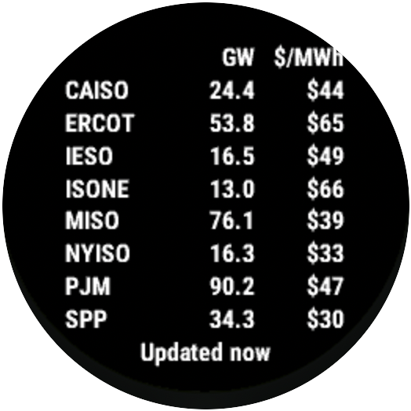
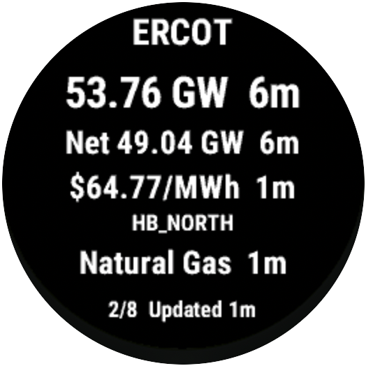
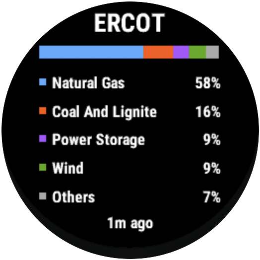

# Grid Status for Garmin

[](https://github.com/WillKoehrsen/gridstatus-garmin/actions/workflows/test.yml)

A Connect IQ watch app that shows current grid conditions for CAISO, ERCOT, IESO, ISO-NE, MISO, NYISO, PJM and SPP from the [Grid Status API](https://www.gridstatus.io/api). It runs on [84 Garmin watches](docs/devices.md), including recent Forerunner, fenix, epix, Venu, vivoactive and MARQ models.

<p>
  
  
  
</p>

Each person uses their own API key. Create one on your [Grid Status API settings page](https://www.gridstatus.io/settings/api). The watch fetches data through the Garmin Connect app, so your phone must be connected.

## Install

The app isn't on the Connect IQ Store yet. Until it is, you can build your own copy with your key inside, on GitHub, without installing any tools:

1. Find your watch's device ID in [docs/devices.md](docs/devices.md).
2. Click **Use this template > Create a new repository** at the top of this page and choose **Private**. The app file will contain your API key, so the copy must be private.
3. In your new repository, open **Settings > Secrets and variables > Actions**, click **New repository secret**, name it `GRIDSTATUS_API_KEY` and paste your key.
4. Open **Actions > Build your own copy**, click **Run workflow**, enter your device ID and run it.
5. When the run finishes, download the file listed under **Artifacts** on its page and unzip it to get `GridStatus.prg`.
6. Connect your watch by USB and copy `GridStatus.prg` into its `GARMIN/Apps` folder, using File Explorer on Windows or [OpenMTP](https://openmtp.ganeshrvel.com) on a Mac. If the watch doesn't show up, set **Settings > System > USB Mode** to **MTP** on the watch.
7. Unplug the watch. The app appears in its app list.

To get a newer version later, create a new copy and run the workflow again.

## Screens

- **Overview:** load and hub price for every ISO on one screen.
- **ISO:** load, net load, hub price and primary fuel, with the age of each value. The bottom line shows when the app last fetched data.
- **Fuel mix:** the largest sources for one ISO, from `{iso}_fuel_mix`. Shares count only positive values, so storage that is charging is left out.
- **Glance:** the last ISO you viewed, in the watch's glance list. Add it from the watch's glance settings. It shows saved data and never sends a request.

The app reopens on the page you last viewed.

## Controls

| Screen | UP / DOWN | START | BACK |
|---|---|---|---|
| Overview | Next or previous page | Refresh | Exit |
| ISO | Next or previous page | Open fuel mix | Exit |
| Fuel mix | Nothing | Refresh | Back to the ISO |

## API quota

The overview, ISO pages and glance share one request. Each ISO's fuel mix is one more. The app reuses each response for 5 minutes, so opening a screen or pressing START in that window doesn't send a request. Changing the API key always fetches.

## Setup

```bash
brew install --cask connectiq connectiq-sdk-manager
```

Open the SDK Manager, sign in, and download the Forerunner 255 Music device files.

The cask moves `ConnectIQ.app` to `/Applications`, but the simulator reads `version.txt` from the app's folder. Without this link it shows `can't open file '/Applications/version.txt'` and stalls until the dialog is dismissed. Run this again after upgrading the SDK:

```bash
ln -sf "$(dirname "$(readlink -f "$(which monkeyc)")")/version.txt" /Applications/version.txt
```

Generate a developer key:

```bash
mkdir -p ~/.connectiq
openssl genrsa -out ~/.connectiq/developer_key.pem 4096
openssl pkcs8 -topk8 -inform PEM -outform DER -in ~/.connectiq/developer_key.pem -out ~/.connectiq/developer_key.der -nocrypt
```

## Build

| Command | Output | API key |
|---|---|---|
| `scripts/build.sh` | `bin/GridStatus.prg` | None; read from the app setting |
| `scripts/build_sideload.sh` | `bin/GridStatusSideload.prg` | Compiled in |
| `scripts/package.sh` | `bin/GridStatus.iq`, the store package for every watch | None; read from the app setting |

Settings can't be edited on a sideloaded app, so use the sideload build on your own watch. **Never share or publish that build, or the `bin/GridStatusSideload-settings.json` written beside it.** The key comes from `GRIDSTATUS_API_KEY`, falling back to the gitignored `.env` in the repository root, and is also written to the gitignored `resources-local/properties.xml`.

The build scripts target the Forerunner 255 Music (`fr255m`). Set `GRIDSTATUS_DEVICE` to build for another watch in `manifest.xml`. Layouts are measured on each watch's screen: text steps down to smaller fonts and columns size to their widest value, so check new watches in the simulator before adding them.

To publish to the Connect IQ Store, follow [docs/store-listing.md](docs/store-listing.md).

## Test

GitHub Actions builds the app, runs the unit tests and builds the store package for every watch on each push to `main` and each pull request, using a container with the Connect IQ SDK and a headless simulator.

To run the unit tests locally, open the simulator first:

```bash
open -a /Applications/ConnectIQ.app
scripts/test.sh
```

To run the app in the simulator:

```bash
monkeydo bin/GridStatusSideload.prg fr255m
```

The simulator keeps settings between builds, so after running a keyless build the sideload build also shows "Add your API key". Clear it with **File > Reset All App Data**. To try a key in the keyless build, use **File > Edit Persistent Storage > Edit Application.Properties data**.

## Install a development build

Connect the watch by USB and set **Settings > System > USB Mode** to **MTP**. Quit Garmin Express and OpenMTP if they're running. Then find the ID of the `GARMIN/Apps` folder and send the app using that ID, because `mtp-sendfile` can't resolve the folder by path:

```bash
brew install libmtp
mtp-folders 2>/dev/null | grep Apps
mtp-sendfile bin/GridStatusSideload.prg <Apps folder ID>/GridStatusSideload.prg
```

Unplug the watch to finish the install. Sending a new build updates the installed app, which no longer appears in the folder afterwards, so there is nothing to delete first. The watch fetches data through the Garmin Connect app, so your phone must be connected.

## License

The code is released under the [MIT License](LICENSE). The Grid Status name and logo belong to Grid Status and aren't covered by the license. See [PRIVACY.md](PRIVACY.md) for what the app sends.
